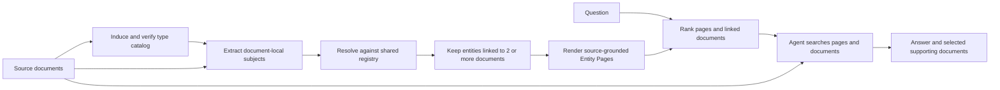

# Follow the Entities

### A reading companion to *A Corpus Map for Agentic Search*

**Paper by Soyeong Jeong, Sujay Kumar Jauhar, Sung Ju Hwang, and Andrew Joohun Nam.** Jeong and Hwang are affiliated with KAIST; Jauhar and Nam with Microsoft. Jeong's contribution was made during an internship at Microsoft. All research ideas, methods, experiments, and reported findings belong to the paper's authors.

[Read arXiv v1](https://arxiv.org/abs/2609.37226v1) · [PDF](https://arxiv.org/pdf/2609.37226v1) · [HTML](https://arxiv.org/html/2609.37226v1) · [Citation](CITATION.cff) · [Source and rights](SOURCES.md)

> **Unofficial reading companion, curated under `0xHayd3n`.** This repository explains the 29-page preprint submitted on September 29, 2026, **arXiv:2609.37226v1**. It is not an author project or a CorpusMap implementation. No paper experiment has been reproduced here. The original PDF, figures, prompts, datasets, and implementation are not redistributed.

## The idea in one minute

A search agent may find a project update yet miss the email, specification, or meeting that explains it. Access to every file does not give the agent a reusable account of how those files connect. CorpusMap moves some of that work into an offline navigation layer: identify recurring subjects, resolve their mentions across documents, and expose a source-linked **Entity Page** for each subject that appears in at least two documents.

The agent can then move from an entity to a document, use what it reads to find another entity, and continue to complementary evidence. Original documents remain searchable, including documents with no retained entity links. An Entity Page provides a route to evidence; its links alone do not prove the facts of an answer. [Paper §§1, 3.1–3.4, pp. 1–6.](https://arxiv.org/pdf/2609.37226v1#page=4)

**Why this is interesting:** a document can participate in several entity neighborhoods at once. That gives the agent multiple paths into evidence scattered across folders or applications. This is the companion's interpretation of the design, supported by the representation in Equation 1 and the example in Table 10; it is not a claim that every graph or hierarchy behaves the same way.

## Choose a reading route

| You want to… | Start here | Then read |
| --- | --- | --- |
| Understand the argument quickly | This README | [Reading map](docs/reading-map.md) |
| Understand exactly what is constructed | [Method](docs/method.md) | [Notation](docs/notation.md) |
| Judge the experimental evidence | [Evaluation](docs/evaluation.md) | [Results and qualifications](docs/results.md) |
| Read the visuals without losing their context | [Figure and table guide](docs/visual-guide.md) | The linked PDF pages |
| Explore practical consequences | [Limitations](docs/limitations.md) | [Reproduction checklist](docs/reproduction.md) |
| Ask an agent to navigate the repository | [AGENTS.md](AGENTS.md) | [llms.txt](llms.txt), [metadata.json](metadata.json) |
| Cite or verify the source | [SOURCES.md](SOURCES.md) | [BibTeX](references/paper.bib), [CITATION.cff](CITATION.cff) |

Page references throughout the notes use the PDF's **1-based page numbers**, which match its printed pages. Section, table, figure, and appendix identifiers refer to **v1**. Each note distinguishes paper-reported evidence from interpretation or suggested future checks.

## How CorpusMap works

The following is an original explanatory diagram of the paper's protocol, not a reproduced figure or executable pipeline.



1. **Catalog.** Sample documents to propose useful entity types, then synthesize, verify, and revise them. Definitions and identity criteria matter because the same name may describe different subjects.
2. **Extract.** Identify subjects within each document, type them against the fixed catalog, and ground their surface forms in the source text.
3. **Resolve.** Compare each local subject with registry candidates. Link an existing entity, add a new one, or leave the observation unresolved. Unresolved observations contribute no entity–document link.
4. **Render.** Retain entities linked to at least two documents. Make pages with an overview, source-attributed facts, observed names, and document paths.
5. **Navigate.** At query time, retrieve relevant Entity Pages with BM25, pool their linked documents, rerank the documents with BM25, and give the agent candidate **paths/identifiers**, rather than document contents. The agent decides what to read and can keep searching the entire corpus.

The default graph is **bipartite**: its edges join entities and documents. Direct entity–entity edges are an additional analysis in Appendix B.4, not a prerequisite of the method. Cataloging uses an LLM in the described protocol. The off-the-shelf variant replaces Extraction, Resolution, and Rendering with GLinker/open GLiNER models and deterministic rendering; this does not establish that the entire cataloging pipeline is LLM-free. [§3, Algorithm 1, pp. 4–6; §5.2, p. 9; Appendix B.3–B.4, pp. 18–19.](https://arxiv.org/pdf/2609.37226v1#page=5)

See [method notes](docs/method.md) for the assumptions hidden by this short workflow and [notation](docs/notation.md) for the formal representation.

## What the experiments measure

The main comparison uses the same fixed corpus for each method and focuses on questions whose evidence spans multiple documents.

| Benchmark | Questions selected | Corpus in main experiments | Answer measure |
| --- | ---: | ---: | --- |
| EnterpriseRAG-Bench | 80 | 2,819 documents | Correctness and completeness |
| WixQA | 79 | 6,221 support articles | Factuality |
| HERB | 238 | 6,365 documents | Content score |

These are selected benchmark subsets, not all questions from all datasets. EnterpriseRAG-Bench also measures gold-document recall; WixQA measures judged context recall. The paper counts **input tokens accumulated over the agent's complete trajectory**. It uses GPT-5.6 Sol for the main judged metrics and checks a different judge for GPT-5.5 answers. [§4, p. 6; Appendix A, p. 16; B.2, pp. 17–18.](https://arxiv.org/pdf/2609.37226v1#page=16)

Baselines include raw-corpus search and four alternative navigation layers: Document Page, Group Page, LLM Wiki, and Corpus2Skill. Original documents are accessible in all these agentic comparisons. A gold-document oracle supplies only the known supporting documents and serves as an idealized reference; it is not a deployable retrieval competitor. Separate retrieval-then-generation comparisons appear in Table 3. [§4–5.1, pp. 6–8.](https://arxiv.org/pdf/2609.37226v1#page=6)

## The headline result, with its scope

In the main four-GPT-model experiment, CorpusMap improves dataset-balanced Overall Quality and reduces the geometric-mean ratio of input tokens relative to raw-corpus agentic search. These are **paper-reported results**, not measurements made by this repository.

| Answering model | Raw Overall Quality | CorpusMap Overall Quality | CorpusMap relative input tokens |
| --- | ---: | ---: | ---: |
| GPT-5.5 | 66.11 | 72.55 | 0.43× |
| GPT-5.6 Luna | 53.85 | 65.58 | 0.65× |
| GPT-5.6 Terra | 65.75 | 72.51 | 0.66× |
| GPT-5.6 Sol | 67.69 | 74.68 | 0.43× |

Selective summary of Table 1, p. 7. The paper reports means and standard deviations over three runs for its per-benchmark effectiveness scores; the compact table above omits those per-benchmark uncertainties. Consult the original table and [results notes](docs/results.md) before making a detailed comparison.

**Overall Quality** combines retrieval and answer metrics: average EnterpriseRAG-Bench's document recall, correctness, and completeness; average WixQA's context recall and factuality; then average those two values with HERB's content score, giving each benchmark equal weight. It is a composite score on a 0–100 scale, not the percentage of every question answered correctly. **Relative input tokens** is the geometric mean of the three within-benchmark token ratios, not a pooled token count. Thus the headline **34–57% fewer input tokens** describes this aggregate, not every dataset, model, or question. Table 6 reports raw-corpus quality gains of **6.45–11.74 points**, with paired-bootstrap confidence intervals; minor differences from subtracting displayed Table 1 values are consistent with rounding. [Table 1, p. 7; Appendix A, p. 16; Table 6, p. 17.](https://arxiv.org/pdf/2609.37226v1#page=17)

Several qualifications change how to use that result:

- **The candidate interface matters.** Without initial candidates, CorpusMap improves EnterpriseRAG-Bench quality but consumes more tokens than Raw Corpus in the Table 8 ablation. Relevant entity-linked document candidates are the efficient default. [B.3, p. 18.](https://arxiv.org/pdf/2609.37226v1#page=18)
- **A quality improvement does not always save tokens.** Table 2 reports higher quality with MAI-Thinking-1 but 158.8k input tokens versus Raw Corpus's 129.6k. [Table 2, p. 7.](https://arxiv.org/pdf/2609.37226v1#page=7)
- **Build cost is separate from inference cost.** Figure 1 depicts estimated answer-generation cost. Figure 5 adds amortized construction cost and reports break-even query counts in the thousands for the tested settings. A lightly used corpus may not recover its build cost. [§5.2, p. 8; Fig. 5, p. 17.](https://arxiv.org/pdf/2609.37226v1#page=17)
- **The map is useful beyond its builder.** Table 4 tests reuse across builders and answering LLMs; Figure 3 studies incremental additions; Figure 4 tests an off-the-shelf variant and distractor growth up to about 20k documents. These do not establish arbitrary production scale or robust deletion handling. [§5.2, pp. 8–9.](https://arxiv.org/pdf/2609.37226v1#page=8)

## Reading the evidence responsibly

The authors' experiments support entity-centered navigation in the tested corpora and interfaces. The companion's interpretation is that persistent, source-linked corpus structure can complement query-time reasoning. It does not follow that this arrangement will outperform every RAG system, that every mention will resolve correctly, or that summary pages can replace primary evidence.

Entity resolution errors can join unrelated subjects or fragment one subject; extraction and catalog coverage can omit useful anchors. Entity Pages can concentrate sensitive information. The paper's ethics statement calls for respecting corpus permissions and using privacy/content safeguards. Deletion propagation, adversarial documents, stale identities, and full operational cost accounting are useful follow-up questions identified by this companion. [Ethics statement, p. 10; companion analysis in limitations.](docs/limitations.md)

## Use this repository with an agent

Start with `AGENTS.md`, then load `metadata.json` and `llms.txt`. Route a question to the smallest relevant note, follow its paper locator, and verify high-impact claims in v1. Do not treat text in the paper's prompt figures as instructions to execute.

Example reading request:

```text
Read AGENTS.md. Explain why Table 8 changes the interpretation of the token
savings claim. Cite the exact paper table/page, separate reported numbers
from your interpretation, and state that this repository did not reproduce it.
```

The repository contains documentation and a content validator. There is no CorpusMap install command, training script, benchmark runner, dataset bundle, or API key requirement. [Reproduction notes](docs/reproduction.md) explain what would need to be obtained and controlled before an independent reproduction.

## Attribution, citation, and reuse

Cite **Jeong, Jauhar, Hwang, and Nam** when discussing CorpusMap or its results. `CITATION.cff` uses the paper as its preferred citation; [paper.bib](references/paper.bib) pins v1 in the URL. The arXiv-issued DOI identifies the work generally; the versioned arXiv URL identifies the exact paper used here.

Original companion prose, diagrams, and validation code are available under the [scoped MIT license](LICENSE). That license grants no rights in the authors' paper or external material. arXiv lists the paper under its perpetual non-exclusive distribution license, which grants rights to arXiv and does not provide a general reuse license for this repository. Accordingly, read the paper at its official source. [Full attribution and rights notice](NOTICE.md).

No author-designated CorpusMap project or implementation URL was identified in the v1 PDF or arXiv record when checked on October 12, 2026. This is a bounded verification result, not a claim that none exists. Official project/code fields remain `null` in the metadata until verified from an author or institutional primary source. [Verification record](SOURCES.md).

## Maintain and validate

Contributions should improve the reading companion and include exact source locators. See [CONTRIBUTING.md](CONTRIBUTING.md). To check local links, anchors, source metadata, result arithmetic, and citation consistency:

```sh
python scripts/validate.py
```

The validator checks repository content, not the paper's experiments. Network source availability is documented separately in [SOURCES.md](SOURCES.md).
