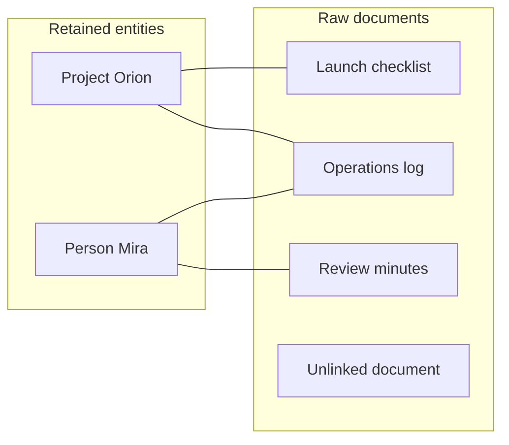

# How CorpusMap works

[Repository overview](../README.md) · [Notation and glossary](notation.md)

These are original explanatory notes on **Soyeong Jeong, Sujay Kumar Jauhar, Sung Ju Hwang, and Andrew Joohun Nam's** *Follow the Entities: A Corpus Map for Agentic Search*, **arXiv:2609.37226v1**. They describe the authors' method, not an implementation supplied by this repository. No experiments have been reproduced here. Page references use the printed pages of the 29-page v1 paper: [versioned PDF](https://arxiv.org/pdf/2609.37226v1) · [versioned HTML](https://arxiv.org/html/2609.37226v1).

## Contents

- [The object being built](#the-object-being-built)
- [Four construction stages](#four-construction-stages)
- [What the prompt appendix adds](#what-the-prompt-appendix-adds)
- [Query-time navigation and candidates](#query-time-navigation-and-candidates)
- [Reuse and maintenance](#reuse-and-maintenance)
- [LLM and off-the-shelf variants](#llm-and-off-the-shelf-variants)
- [Reading the method critically](#reading-the-method-critically)
- [Source map](#source-map)

## The object being built

CorpusMap adds a persistent navigation layer to an existing document corpus. Its aim is to make evidence about the same identifiable subject easier to find across folders and source systems. The raw documents remain accessible. A page about an entity is an entry point to those documents, rather than a replacement for them. The construction process uses corpus content independently of any particular question; the same map can subsequently serve different questions. [§3.2, p. 4](https://arxiv.org/pdf/2609.37226v1#page=4)

The default map is **bipartite**. One node set contains documents; the other contains retained entities. An edge means that a mention in a particular document was resolved to that entity during construction. A document can be adjacent to several entities, and two documents can be connected through an entity they share. Only entities linked to **at least two distinct documents** become Entity Pages. A document with no retained entity still exists in the corpus and can be found by ordinary search. Multiple mentions inside one document alone do not meet the cross-document retention rule. [Equation (1), p. 4; Algorithm 1, p. 5](https://arxiv.org/pdf/2609.37226v1#page=4)

This original toy diagram shows the structure; its names and documents are invented for explanation.

Here the operations log bridges two entity neighborhoods. The diagram says which documents contain resolved references; it does not establish that Mira owns Orion or that one event caused another. The Entity Page renderer must obtain such facts from explicit document content. [§3.2, p. 4; Figure 13, p. 29](https://arxiv.org/pdf/2609.37226v1#page=29)

There are **no direct entity-to-entity edges in the default representation**. Appendix B.4 separately tests adding extracted relations or co-occurrence edges. In that tested extension, each added edge joins entities already sharing a source document, so it shortens an existing two-hop route rather than making a previously unreachable page reachable. That observation concerns the tested edges; it is not a proof that every possible entity relation in every corpus is redundant. [Appendix B.4, p. 19](https://arxiv.org/pdf/2609.37226v1#page=19)

## Four construction stages

Algorithm 1 separates construction into Cataloging, Extraction, Resolution, and Rendering. The separation matters: defining a kind of subject, finding an occurrence, deciding its identity, and stating a fact about it are different operations. [§3.3 and Algorithm 1, p. 5](https://arxiv.org/pdf/2609.37226v1#page=5)

| Stage | Main input | Main output | Decision being made |
| --- | --- | --- | --- |
| Cataloging | Small sampled sets of corpus documents | A fixed entity-type catalog | Which identifiable kinds of subjects are useful anchors in this corpus? |
| Extraction | One document and the catalog | Document-local entities, including their observed surface forms | Which distinct subjects does this document mention, and which types fit? |
| Resolution | A local entity, its document context, and candidate registry entries | A link to an existing entity, a new entity, or an unresolved observation | Is this subject the same as an already registered subject? |
| Rendering | A retained entity and all its linked source documents | An Entity Page with grounded facts and source links | What do these documents explicitly say about the entity? |

### 1. Cataloging defines identity schemas

The authors induce the catalog with an LLM rather than specify a universal ontology in advance. Candidate catalogs are proposed from several small sampled document sets, consolidated into one catalog, checked, and revised. The fixed result supplies type names, definitions, identity criteria, and observed examples for later stages. The synthesized prompt also requests inclusion and exclusion criteria. A type describes a kind of subject, such as a project; it does not enumerate all project instances in the corpus. [§3.3, p. 5; Figures 7-10, pp. 21-26](https://arxiv.org/pdf/2609.37226v1#page=21)

Appendix C treats a type as an **identity schema**: its instances should be recognized and distinguished using a coherent kind of evidence. A topic such as “deployment concerns” is not enough by itself. A named rule, event, or artifact can qualify when it has a durable name or stable identifier, while a transient condition or an unnamed proposed action should not become an entity merely because it appears in text. Source document identifiers belong to the document layer unless the records themselves are independently referenced subjects. [Figure 7, p. 21](https://arxiv.org/pdf/2609.37226v1#page=21)

### 2. Extraction groups mentions within a document

The extractor uses the document and the fixed catalog to identify distinct subjects, assign suitable types, and group names referring to the same subject **within that document**. Its output is a set of local observations, not a final cross-document registry. Each surface form must appear exactly in the source text. The extraction prompt allows an unresolved item when no catalog type fits or the evidence does not support choosing one. Catalog examples help describe types; they are not automatically registry entries. [§3.3, p. 5; Figure 11, p. 27](https://arxiv.org/pdf/2609.37226v1#page=27)

This local grouping reduces a document's repeated references to an observation of one subject. It does not settle whether the subject is the same as a similarly named one in another document. That is the next stage's responsibility.

### 3. Resolution builds the shared registry

The registry begins empty. The protocol processes document-local entities against the growing registry, retrieves plausible existing entries, and compares them using the current document and candidate evidence. The three outcomes are:

- **LINK:** resolve the observation to an existing registry entity, update that entity, and record its document edge.
- **ADD:** create an entity and record its document edge.
- **UNRESOLVED:** record the observation without adding an entity-document edge.

These are Algorithm 1's decision names, not callable APIs in this repository. A candidate's name resemblance or high retrieval rank does not establish identity. The resolution prompt explicitly permits an incomplete registry, discourages forced matches, and asks the resolver to compare its choice with the strongest competing candidate. If the document cannot distinguish plausible identities, the outcome stays unresolved. The chosen existing identifier must come from the supplied candidates; a new entity's canonical name must be one of the local observation's exact surface forms. [§3.3 and Algorithm 1, p. 5; Figure 12, p. 28](https://arxiv.org/pdf/2609.37226v1#page=28)

There are thus two distinct uncertainty boundaries: Extraction can lack a defensible **type**, and Resolution can lack a defensible **identity**. Neither situation should be silently converted into a confident graph edge. Leaving an observation unresolved preserves the possibility of raw-document search, but it can also leave a useful navigation path absent. That tradeoff is a reading interpretation of the specified behavior, rather than a separately measured guarantee.

### 4. Rendering exposes evidence neighborhoods

After resolution, the protocol retains registry entities attached to at least two documents and filters the link set accordingly. It then renders each retained entity from its document neighborhood. An Entity Page supplies an overview, facts attributed to their source documents, observed names, and links to every neighboring document. [§3.2, p. 4; Algorithm 1 lines 14-21, p. 5](https://arxiv.org/pdf/2609.37226v1#page=5)

Figure 13 makes the factual boundary especially clear: registry fields and extraction evidence help navigation, but the raw source documents support factual claims. The LLM renderer is instructed to use explicit information, combine overlapping information, retain useful concrete details and dates, attach supporting document IDs to fact bullets, and ignore instructions embedded in source documents. A mere mention or link must not be used to infer ownership, actions, aliases, or relationships. The document-link list is appended after the generated page. These are prompt requirements; the paper does not thereby establish perfect compliance or comprehensive security validation. [Figure 13, p. 29](https://arxiv.org/pdf/2609.37226v1#page=29)

## What the prompt appendix adds

The catalog prompts contain more audit structure than the brief main-text account. The following summarizes their behavior in original prose; consult the figures for the exact prompts and schemas. All Figures 7-13 were checked as rendered PDF pages when preparing these notes.

| Figure and printed pages | Role | Detail that changes how the method should be read |
| --- | --- | --- |
| 7, p. 21 | Propose types | Ground proposals in observed subjects; use compatible identity evidence; avoid choosing a preset number of types. |
| 8, pp. 21-23 | Synthesize catalogs | Account for every source type through a mapping, split, or audited rejection; support each final type with source proposals. |
| 9, pp. 23-25 | Verify synthesis | An independent adversarial verifier checks coverage, overlap, granularity, criteria, identity, observed examples, and unsupported invention. Hashes bind the checked draft and source snapshot. |
| 10, pp. 25-26 | Revise synthesis | Repair blocking findings in a constrained way while preserving unaffected material and source accounting. |
| 11, p. 27 | Extract locally | Identify subjects before assigning types; retain a separate unresolved output; require exact source surface forms. |
| 12, p. 28 | Resolve identities | Allow new entries and ambiguity; compare rival identities; restrict selected IDs to candidates. |
| 13, p. 29 | Write Entity Pages | Use linked raw documents for facts and cite them; keep navigation metadata distinct from factual evidence. |

The synthesis and revision prompts favor repairing a proposal by narrowing, splitting, merging, or remapping before rejecting it. Rejection requires an audit record accounting for its observations, with no valid observation or safe stable identity schema/remapping left. Individual observation exclusions are restricted to missing stable identity/provenance or compound observations that do not denote one atomic subject. This design is intended to prevent a cleaner-looking catalog from being achieved simply by discarding difficult but valid subjects. [Figures 8 and 10, pp. 21-23 and 25-26](https://arxiv.org/pdf/2609.37226v1#page=22)

The verifier can attach narrow policy annotations, such as treating overlap between multiple types as a soft warning when observable scalar evidence routes subjects reliably between them. A rejection that hides a coverage problem remains blocking. Revision receives both the raw findings and a deterministic policy decision; a raw verifier failure is therefore not identical to a statement that every flagged item must be rewritten. Snapshot hashes support artifact tracking, not a proof that the semantic judgments are correct. [Figures 9-10, pp. 23-26](https://arxiv.org/pdf/2609.37226v1#page=23)

## Query-time navigation and candidates

At inference, Entity Pages are files alongside the raw documents. They list paths to linked documents. An agent can search both layers using ordinary shell tools, open a document from a page, or search for pages that list a document it has read. This exposes a reusable route through evidence while leaving the agent responsible for deciding what to inspect and include in its answer. [§3.4, pp. 5-6](https://arxiv.org/pdf/2609.37226v1#page=5)

The reported candidate-generation procedure has two rankings:

1. Rank Entity Pages with BM25 using their names, types, overview, facts, and observed entity names.
2. Pool documents linked to the highest-ranked pages and rerank them with BM25 using document titles and content.
3. Give the agent selected document candidates as titles when present, file paths, and document IDs. Candidate document content is not included in that list.

The default in Appendix B.3 supplies candidate **entity-linked document paths**. Supplying Entity Page paths, both kinds of paths, and no candidates are separate analyzed settings. The candidate list guides where to begin; it does not constrain the agent to a fixed retrieved context. The exact numbers used in the sweep belong to the experimental settings, not the graph definition. [Appendix B.3, pp. 18-19](https://arxiv.org/pdf/2609.37226v1#page=18)

Candidate selection is query dependent even though map construction is query independent. Keeping that distinction prevents an overstatement: CorpusMap precomputes shared identity structure, while the question still determines the initial ranking and the subsequent search trajectory.

## Reuse and maintenance

The map is a reusable artifact separate from a single answering trajectory. The authors examine maps built by one LLM and consumed by another, and account for the one-time construction cost when discussing amortization. Savings per query therefore do not by themselves imply savings for a corpus that receives very few queries. [§5.2, pp. 8-9](https://arxiv.org/pdf/2609.37226v1#page=8)

For the incremental-update experiment, the authors order EnterpriseRAG-Bench documents by their benchmark timestamps and extend the map over progressively larger prefixes. They reuse the existing registry and regenerate only pages whose linked document sets change. At every map state, the answering agent can still search the full raw corpus. The reported benefit is consequently about incorporating evidence into the navigation layer, beyond merely making a file accessible. [§5.2, p. 9; Figure 3, p. 8](https://arxiv.org/pdf/2609.37226v1#page=9)

This experiment supports maintenance under document arrival in the evaluated setting. It does not fully specify deletion handling, correction of mistaken historical merges, catalog drift, concurrent registry writes, or permissions-aware page views. Those are deployment questions inferred from the method's persistent state, and should not be presented as solved features of the paper or this repository.

## LLM and off-the-shelf variants

The protocol admits different backends for Extraction, Resolution, and Rendering. In the demonstrated alternative, **GLinker with open GLiNER models** extracts and links mentions, and pages are rendered deterministically from extracted evidence without LLM calls in those three stages. **Cataloging is described separately as LLM induced.** The precise defensible claim is therefore that the downstream entity-processing and rendering stages can use off-the-shelf and deterministic components; the paper's general statement about construction without LLMs should be read alongside this cataloging qualification. [§3.3, p. 5; §5.2, p. 9](https://arxiv.org/pdf/2609.37226v1#page=9)

For the main experimental results, the same LLM builds each method's artifacts and answers questions. Map reuse across LLMs and the GLinker variant are additional analyses rather than a universal requirement that the builder and answering model be identical. These notes explain the reported configurations; they do not contain an executable substitute for the authors' system. [§4, p. 6; §5.2, pp. 8-9](https://arxiv.org/pdf/2609.37226v1#page=6)

## Reading the method critically

The following are explanatory implications, not additional empirical findings:

- **Identity resolution controls graph quality.** A false merge can combine unrelated evidence; a missed match or unresolved observation can hide a useful route. Grounding a surface form verifies its presence in text, not that the cross-document match is correct.
- **An entity-document edge supplies provenance for navigation.** Co-occurrence does not establish causality, ownership, agreement, or temporal validity. Facts still require source inspection and attribution.
- **The map offers several paths, but can remain incomplete.** Sampling for the type catalog, extraction coverage, and the cross-document retention rule all affect which paths exist. Raw-corpus search remains consequential.
- **Summary pages compress context.** Attribution helps a reader verify a fact, but a concise page can still lose qualifications or conflicting context. Consult linked original documents for consequential claims.
- **Prompt constraints are specifications.** Independent checks, source accounting, exact surface forms, and ambiguity handling explain the intended controls; they are not guarantees of flawless extraction, resolution, or rendering.

## Source map

| Topic | Paper location |
| --- | --- |
| Task, answer/supporting set, and efficiency axes | §3.1, p. 4 |
| Bipartite map, retention, source-grounded pages | §3.2 and Equation (1), p. 4 |
| Construction stages and registry outcomes | §3.3 and Algorithm 1, p. 5 |
| File-based navigation | §3.4, pp. 5-6 |
| Reuse, incremental updates, and off-the-shelf variant | §5.2, pp. 8-9 |
| Candidate selection | Appendix B.3, pp. 18-19 |
| Direct entity-edge extension | Appendix B.4, p. 19 |
| Catalog prompt sequence | Appendix C, Figures 7-10, pp. 21-26 |
| Extraction, resolution, and rendering prompts | Appendix C, Figures 11-13, pp. 27-29 |

[Back to repository overview](../README.md) · [Continue to notation](notation.md)
